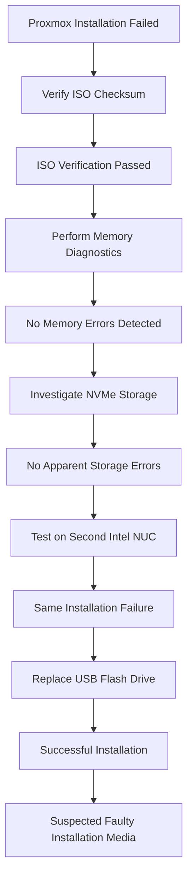

# Proxmox VE Installation and Troubleshooting

## Project Overview

The objective of this project was to install Proxmox VE on a physical Intel NUC to establish the virtualization infrastructure for my enterprise home lab.

During installation, I encountered repeated kernel package extraction failures that required systematic troubleshooting and hardware isolation.

## Hardware Environment

| Component | Specification |
|---|---|
| Device | Intel NUC |
| Processor | Intel Core i7-8809G |
| Memory | 32 GB RAM |
| Storage | Samsung 970 EVO Plus 500 GB NVMe |
| Hypervisor | Proxmox VE |
| Installation Method | Bootable USB |

## Problem Description

During the Proxmox VE installation, the installer repeatedly failed while extracting and installing the kernel package.

### Error Message

    installation of package
    proxmox-kernel-7.0.2-6-pve-signed_7.0.2-6_amd64.deb
    failed

Additional error messages indicated corrupted compressed data during package extraction.

The installation could not proceed successfully.

## Troubleshooting Flowchart

## Troubleshooting Methodology

I followed a systematic process to identify and isolate the potential cause of the installation failure.

### 1. ISO Integrity Verification

- Downloaded a fresh Proxmox VE ISO.
- Verified the ISO checksum.
- Confirmed that the downloaded installation image passed integrity verification.

Result: ISO download corruption became less likely.

### 2. Memory Diagnostics

- Performed memory diagnostics using MemTest.
- Checked for potential RAM-related data corruption.
- No memory errors were detected during testing.

Result: Faulty RAM became less likely.

### 3. Storage Investigation

- Investigated the NVMe SSD for potential storage-related errors.
- No apparent storage I/O errors were identified.

Result: No evidence of SSD failure was found during troubleshooting.

### 4. Hardware Isolation

- Attempted installation on a second Intel NUC.
- Used the same USB installation media.
- Encountered a similar installation failure.

Result: The issue was reproduced on two separate physical machines, suggesting a shared component was responsible.

### 5. Installation Media Replacement

- Replaced the original USB flash drive with a SanDisk USB flash drive.
- Recreated the bootable Proxmox installation media.
- Reattempted the installation.

Result: Proxmox VE installed successfully.

## Root Cause Analysis

The original USB installation media was identified as the most likely source of the installation failure.

The successful installation after replacing the USB drive, combined with the previous diagnostic results, strongly suggested an issue with the original flash drive or its written installation media.

The exact physical cause was not independently confirmed.

## Resolution

Successfully installed Proxmox VE using replacement USB installation media and authenticated to the system using the root account.

## Skills Demonstrated

- Systematic troubleshooting
- Hardware fault isolation
- ISO checksum verification
- Memory diagnostics
- Storage troubleshooting
- Bootable installation media creation
- Root cause analysis
- Hypervisor deployment
- Linux system administration

## Lessons Learned

- A successful ISO checksum verification does not guarantee the integrity of the USB installation media.
- Reproducing an issue on separate machines can help isolate shared components.
- Hardware and software troubleshooting should follow a structured process rather than relying on assumptions.
- Installation media should be considered when package extraction or data corruption errors occur.

## Project Status

- [x] Identify installation failure
- [x] Verify ISO integrity
- [x] Perform memory diagnostics
- [x] Investigate storage errors
- [x] Test on secondary hardware
- [x] Replace installation media
- [x] Successfully install Proxmox VE
- [ ] Establish network connectivity
- [ ] Validate web management interface
- [ ] Deploy first virtual machine

## Outcome

Proxmox VE installation was successfully completed, establishing the foundation for future virtualization, networking, and enterprise infrastructure projects.

## Troubleshooting Flowchart

